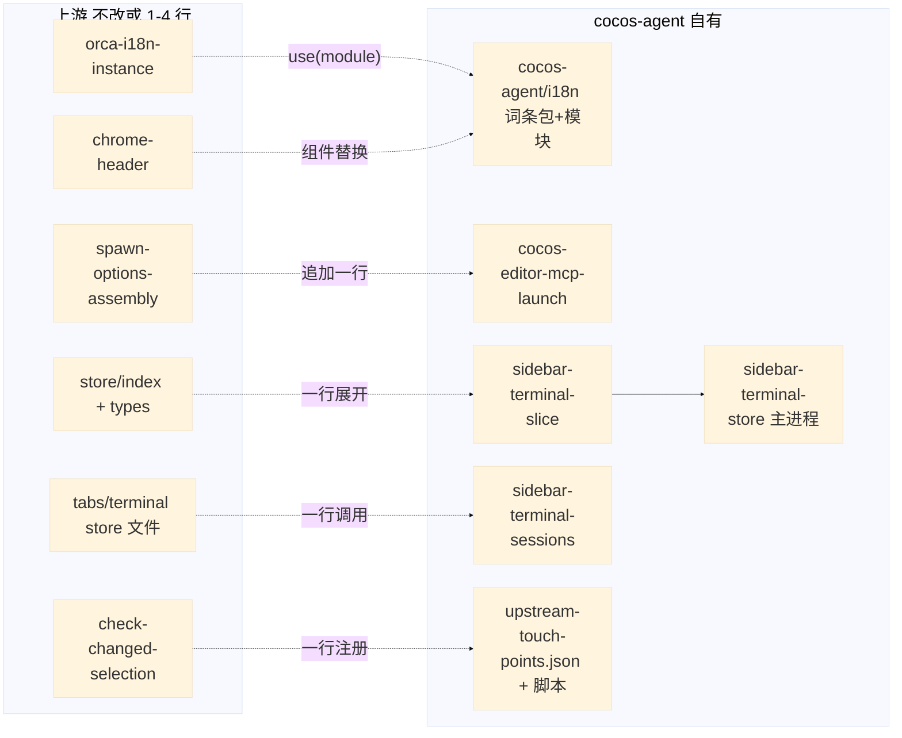

# cocos-agent 低冲突上游同步 — Implementation Blueprint

| Field             | Value                                                                                                                                                                                                                                                                                                                |
| ----------------- | -------------------------------------------------------------------------------------------------------------------------------------------------------------------------------------------------------------------------------------------------------------------------------------------------------------------- |
| **Status**        | Complete                                                                                                                                                                                                                                                                                                             |
| **Date**          | 2026-11-08                                                                                                                                                                                                                                                                                                           |
| **Author**        | sky <sky.jp@a5labs.co>                                                                                                                                                                                                                                                                                               |
| **Source**        | `./upstream-sync-conflict-reduction-rfc.md`（Accepted）                                                                                                                                                                                                                                                              |
| **Implemented**   | 2026-11-09（dev/0.1.1，6 个主题提交；推送与 PR 由用户在沙箱外执行）                                                                                                                                                                                                                                                  |
| **Analysis mode** | graph-assisted — `list_repos` + 全量 `analyze` 通过；改动面由 `git diff --numstat 974bb4a7cab HEAD` 和逐文件 diff 定位；blast radius 来自 RFC 的 8 次 `impact` 调用（`target.filePath` 已核对）；扩展点（i18next 3rdParty 模块、`addResourceBundle`、`StateCreator` slice 组合、`state.store.updateUI`）由 Read 确认 |

## Requirement

把 cocos-agent 对 Orca 上游文件的改动从 62 个文件收缩到少数 1–4 行的追加式挂点，并加一道机械校验让登记表不再落后；同时把与 Cocos 无关的 6 处修复整理成面向 stablyai/orca 的独立提交。设计理由与备选方案见 [RFC](./upstream-sync-conflict-reduction-rfc.md)。第二阶段（侧栏终端改用上游 portal 机制）不在本蓝图内。

## Scope

- **Affected modules**: i18n（主进程 + 渲染进程）、Agent 启动链（`src/main/ipc/pty`）、浏览器标签 chrome、侧栏终端（渲染进程 store 与组件）、持久化 schema（主进程 + 共享合约）、`check:changed` 管道、打包与文档。
- **Target bundles**: 不适用（Electron 应用）。
- **Dependencies**: 无新增依赖。

## Architecture Design

### Component Overview

| Component                     | Location                                                                                                      | Responsibility                                                                                                  |
| ----------------------------- | ------------------------------------------------------------------------------------------------------------- | --------------------------------------------------------------------------------------------------------------- |
| `cocos-agent-i18n`            | `src/shared/cocos-agent/i18n/`                                                                                | 三个语言 JSON + i18next `3rdParty` 模块（init 时 `addResourceBundle(lng, 'cocosAgent', …)`）+ `cocosAgentKey()` |
| `cocosText` / `cocosTextMain` | `src/renderer/src/cocos-agent/cocos-text.ts`、`src/main/cocos-agent/cocos-text-main.ts`                       | 命名不以 `translate` 开头的包装，避开 i18next-cli 提取与上游 en.json 校验                                       |
| `sidebar-terminal-slice`      | `src/renderer/src/cocos-agent/sidebar-terminal-slice.ts`                                                      | 侧栏归属状态、焦点、action、默认页与宽度、hydration                                                             |
| `sidebar-terminal-store`      | `src/main/cocos-agent/sidebar-terminal-store.ts`                                                              | userData 下 `cocos-agent/sidebar-terminals.json` 读写 + 首次运行迁移旧 ui state                                 |
| `sidebar-terminal-sessions`   | `src/shared/sidebar-terminal-sessions.ts`（扩展）                                                             | `selectCentralTerminalTabs`、`activateTerminalTabTarget`、`sidebarSessionsAfterTabClosed`                       |
| `upstream-touch-points`       | `config/cocos-agent/upstream-touch-points.json`、`config/scripts/cocos-agent/check-upstream-touch-points.mjs` | 白名单校验、`COCOS-AGENT.md` 表生成、`upstream-base.json`                                                       |

## File Changes

### New Files

| File Path                                                                      | Purpose                                                                           |
| ------------------------------------------------------------------------------ | --------------------------------------------------------------------------------- |
| `src/shared/cocos-agent/i18n/{en,zh,zh-Hant}.json`                             | 原 `cocosEditor.*`、`cocosSidebar.*` 词条，去掉顶层前缀                           |
| `src/shared/cocos-agent/cocos-agent-i18n.ts`                                   | `cocosAgentI18nModule`（3rdParty）、`COCOS_AGENT_I18N_NAMESPACE`、`cocosAgentKey` |
| `src/renderer/src/cocos-agent/cocos-text.ts`                                   | `cocosText(key, fallback, options?)`                                              |
| `src/main/cocos-agent/cocos-text-main.ts`                                      | `cocosTextMain(key, fallback)`                                                    |
| `src/renderer/src/cocos-agent/sidebar-terminal-slice.ts`                       | slice + `installSidebarTerminalPersistence()`                                     |
| `src/renderer/src/cocos-agent/install-cocos-agent-renderer.ts`                 | 单入口：编辑器标签刷新 + 侧栏持久化（`main.tsx` 挂点保持 2 行）                   |
| `src/main/cocos-agent/sidebar-terminal-store.ts`                               | 文件读写、归一化、旧 ui state 一次性迁移、首次运行 UI 默认值                      |
| `config/cocos-agent/upstream-base.json`                                        | 上次合入的上游 SHA、cocos 包版本、验证记录                                        |
| `config/cocos-agent/upstream-touch-points.json`                                | 允许改动的上游文件 + 冲突处理说明 + 镜像来源                                      |
| `config/scripts/cocos-agent/check-upstream-touch-points.mjs`（含 `.test.mjs`） | 校验 + `--write-doc` 生成 Markdown 表                                             |

### Modified Files

| File Path                                                                                                                                                                                                                                                                                                                                                                                      | Changes                                                                                               |
| ---------------------------------------------------------------------------------------------------------------------------------------------------------------------------------------------------------------------------------------------------------------------------------------------------------------------------------------------------------------------------------------------- | ----------------------------------------------------------------------------------------------------- |
| `src/shared/orca-i18n-instance.ts`                                                                                                                                                                                                                                                                                                                                                             | 现有挂点行 `.use(cocosAgentBrandPostProcessor)` 后追加 `.use(cocosAgentI18nModule)`（仍是同一行挂点） |
| `src/renderer/src/i18n/locales/{en,zh,zh-Hant}.json`、`src/shared/plugins/languages/protected-copy-keys.json`                                                                                                                                                                                                                                                                                  | 恢复上游原样                                                                                          |
| `src/renderer/src/cocos-agent/*.ts(x)`、`src/renderer/src/components/right-sidebar/*.tsx`、`src/main/cocos-agent/cocos-editor-close.ts`、`use-right-sidebar-activity-items.ts`                                                                                                                                                                                                                 | `translate('cocosX.…')` → `cocosText('x.…')`                                                          |
| `src/shared/claude-agent-view-launch.ts`                                                                                                                                                                                                                                                                                                                                                       | 恢复上游原样                                                                                          |
| `src/main/ipc/pty/spawn-options-assembly.ts`                                                                                                                                                                                                                                                                                                                                                   | 恢复上游后在 `launchCommand` 之后追加 `prepareCocosEditorMcpLaunch`（import + 1 个常量 + 1 处引用）   |
| `src/renderer/src/components/browser-pane/assemble-chrome/browser-page-chrome-header.tsx`                                                                                                                                                                                                                                                                                                      | 恢复上游后改为组件替换（import + 1 行常量 + 标签名）                                                  |
| `src/renderer/src/runtime/web-runtime-terminal-create-operation.ts`                                                                                                                                                                                                                                                                                                                            | 恢复上游原样                                                                                          |
| `src/renderer/src/components/right-sidebar/sidebar-terminal-launch.ts`                                                                                                                                                                                                                                                                                                                         | 改调 `createWebRuntimeSessionTerminalResult({ environmentId, … })`                                    |
| `src/renderer/src/store/index.ts`、`src/renderer/src/store/types.ts`                                                                                                                                                                                                                                                                                                                           | 各 +1 行（slice 展开 / 类型交叉）+ import                                                             |
| `src/renderer/src/store/slices/editor/actions/right-sidebar-state.ts`、`src/shared/constants.ts`、`src/shared/persisted-ui-state-types.ts`、`src/main/persistence/applying-settings/ui-state-read.ts`、`worktree-identity-migration.ts`、`use-persisted-ui-writer.ts`、`persisted-ui-write-baseline.ts`、`ui-slice-hydration-actions.ts`、`wsl-move-ui-dispositions.ts`、3 个 persistence 测试 | 恢复上游原样                                                                                          |
| `src/shared/rpc-contract/client-ui-params.ts`、`src/main/persistence/applying-settings/ui-selection-normalization.ts`                                                                                                                                                                                                                                                                          | 恢复上游后只保留 `'terminal'` 枚举 1 行                                                               |
| `src/renderer/src/store/slices/tabs/tabs-focus-actions.ts`、`store/terminals/terminal-tab-navigation.ts`、`terminal-tab-close.ts`、`components/terminal/terminal-tab-bulk-actions.ts`、`terminal-pane/TerminalPaneOverlayLayer.tsx`、`tab-bar/use-tab-bar-item-projection.ts`、`TerminalLegacyTerminalPanes.tsx`                                                                               | 特判改为对 `sidebar-terminal-sessions` 的单行调用                                                     |
| `src/renderer/src/main.tsx`                                                                                                                                                                                                                                                                                                                                                                    | 挂点改为 `installCocosAgentRenderer()`（仍 2 行）                                                     |
| `src/shared/cocos-agent/cocos-editor-types.ts`、`src/preload/cocos-agent-preload.ts`、`src/main/cocos-agent/cocos-agent-ipc.ts`                                                                                                                                                                                                                                                                | 新增 `sidebarTerminals.read/write` 通道                                                               |
| `config/scripts/check-changed-selection.mjs`                                                                                                                                                                                                                                                                                                                                                   | `VERIFY_CHECKS` 增加 1 项                                                                             |
| `.gitattributes`                                                                                                                                                                                                                                                                                                                                                                               | 图标与品牌二进制 `merge=ours`                                                                         |
| `COCOS-AGENT.md`                                                                                                                                                                                                                                                                                                                                                                               | 登记表改为生成；同步流程更新                                                                          |

### Deleted Files

| File Path | Reason |
| --------- | ------ |
| (none)    |        |

## Implementation Steps

### Progress

- [x] Step 1: 分支与上游基线记录
- [x] Step 2: cocos-agent 词条包与 i18n 模块
- [x] Step 3: Agent 启动链挂点整形
- [x] Step 4: 浏览器工具栏挂点整形
- [x] Step 5: 终端创建函数还原
- [x] Step 6: 侧栏终端 slice 与自有持久化
- [x] Step 7: 上游 store/渲染特判收拢
- [x] Step 8: 接入点白名单校验与 merge 属性
- [x] Step 9: 文档与登记表生成
- [x] Step 10: 验证
- [x] Step 11: 面向上游的修复分支
- [x] Step 12: 提交与 PR

### Step 1: 分支与上游基线记录

**Status**: Complete
**Goal**: 在 `dev/0.1.1` 上开展全部改动；记录当前基线。
**Files**: `config/cocos-agent/upstream-base.json`
**Details**:

- `git switch -c dev/0.1.1`（自 `dev/0.1.0` 8230b85a4eb）。
- `upstream-base.json`：`upstreamSha: 974bb4a7cab99cb9735b493d348a33a2b465cd7e`（upstream/main 2026-11-04）、`cocosPackage: 3.8.281`、`mergedInto: dev/0.1.0`。

**Verification**: 分支存在；JSON 可被校验脚本读取。

**Notes**: —

### Step 2: cocos-agent 词条包与 i18n 模块

**Status**: Complete
**Goal**: 四个上游语言文件恢复原样；词条由自有模块在 init 时挂载到 `cocosAgent` 命名空间。
**Files**: 见 New Files 前四项；`orca-i18n-instance.ts` 挂点行；所有 `cocosEditor.*` / `cocosSidebar.*` 调用点。
**Details**:

- i18next 26 在 `init()` 中先建 `ResourceStore` 再调用 3rdParty 模块的 `init(instance)`（`i18next.js` 1871 → 1904），模块内 `addResourceBundle(lng, 'cocosAgent', catalog, true, true)` 对 en / zh / zh-Hant 各一次；不碰 `translation` 命名空间，否则渲染进程 `hasResourceBundle(locale,'translation')` 会跳过上游目录的懒加载。
- `ns` 不加入 init 选项，i18next 不会为它调用 backend；`t('cocosAgent:x')` 直接查 store，未提供的语言回退到 en。
- 包装函数名不以 `translate` 开头（`config/i18next.config.ts` 的 `functions` 为显式列表；脚本的动态键正则匹配 `translate\w*(`）。
- 原键 `cocosEditor.close.message` → `editor.close.message`，`cocosSidebar.terminal.title` → `sidebar.terminal.title`。
- `protected-copy-keys.json` 恢复后运行 `verify:localization-protected-copy` 确认生成结果与上游一致（我们的键不在 en.json，生成器不会再登记它们）。

**Verification**: `node config/scripts/verify-localization-extraction.mjs`、`verify-localization-catalog.mjs`、`protected-copy-keys.mjs` 通过；`git diff dev/0.1.0 -- src/renderer/src/i18n/locales` 为空；单元测试中 `cocosText` 返回 fallback / 词条。

**Notes**: 2026-11-09：所有 cocos 词条迁入 `cocosAgent` 命名空间。踩坑：i18next 26 在 `init()` 里调用 3rdParty 模块时，实例上的 `addResourceBundle` 尚未绑定（它在 1919 行之后才挂到实例），模块内改为 `i18n.store.addResourceBundle`。上游 en.json 里曾被 fork 加入的 `common.ok` 无任何引用，一并移除。

### Step 3: Agent 启动链挂点整形

**Status**: Complete
**Goal**: `claude-agent-view-launch.ts` 回到上游；`spawn-options-assembly.ts` 只在上游 `launchCommand` 之后追加一步。
**Files**: 两个上游文件；`insert-agent-startup-args.ts` 登记为镜像。
**Details**:

- `prepareCocosEditorMcpLaunch` 接收上游算好的 `launchCommand`（已含 `--plugin-dir`），插入 MCP 参数；两者都插在可执行文件之后，顺序无关。
- 不改上游的三元表达式和 `pluginDir` 行。

**Verification**: `src/main/cocos-agent/cocos-editor-mcp-launch.test.ts` 通过；`git diff dev/0.1.0 -- src/shared/claude-agent-view-launch.ts` 为空；`spawn-options-assembly.ts` 对上游的 diff ≤ 10 行且全为追加。

**Notes**: —

### Step 4: 浏览器工具栏挂点整形

**Status**: Complete
**Goal**: 隐藏 Cocos 编辑器页工具栏的改动从 43/40 行变为 ≤ 4 行。
**Files**: `browser-page-chrome-header.tsx`
**Details**:

- `const Toolbar = isCocosEditorPageUrl(currentBrowserUrl) ? HiddenToolbar : BrowserPageToolbar`，JSX 标签改为 `<Toolbar …/>`；`HiddenToolbar` 放在自有目录，接受同一 props 并返回 `null`。

**Verification**: 类型检查通过；diff 不含重缩进。

**Notes**: —

### Step 5: 终端创建函数还原

**Status**: Complete
**Goal**: `web-runtime-terminal-create-operation.ts` 回到上游。
**Files**: 该文件；`sidebar-terminal-launch.ts`
**Details**:

- 上游 `createWebRuntimeSessionTerminalResult(args)` 用 `resolveWebRuntimeSessionEnvironmentId(args.environmentId, settings…)`；侧栏启动显式传 `environmentId`。

**Verification**: 类型检查；`git diff dev/0.1.0 -- src/renderer/src/runtime/web-runtime-terminal-create-operation.ts` 为空。

**Notes**: 2026-11-09：按蓝图先把该文件恢复上游并让侧栏改调 `createWebRuntimeSessionTerminalResult`，但 focus-read ratchet 把该上游函数算作「读取默认主机」的入口，侧栏启动因此被判为新增焦点读取。改回 fork 原有的纯插入式拆分（上游函数委托给新导出的 `createWebRuntimeTerminalForHost`，7 行追加，不改上游行），并登记为挂点。

### Step 6: 侧栏终端 slice 与自有持久化

**Status**: Complete
**Goal**: 9 个持久化 schema 文件、`right-sidebar-state.ts`、`constants.ts` 回到上游；状态与持久化由 cocos-agent 自己承担。
**Files**: 见 New Files / Modified Files 对应行。
**Details**:

- slice 字段名保持 `sidebarTerminalSessionsByWorktree`、`sidebarTerminalFocused` 及四个 action，上游调用点的现有一行引用不变；`StateCreator<AppState, [], [], SidebarTerminalSlice>`，在 `store/index.ts` 展开，在 `types.ts` 的 `AppState` 交叉。
- 主进程 `sidebar-terminal-store.ts`：文件 `userData/cocos-agent/sidebar-terminals.json`（`{ version: 1, byWorktree }`），`writeFileAtomically`；首次运行若 `state.store.getUI()` 里还有旧字段则迁入并通过 `updateUI` 清掉；若无 `cocosAgentUiDefaultsApplied` 标记则 `updateUI({ rightSidebarTab: 'terminal', rightSidebarWidth: 420 })` 并写标记（标记放在同一文件）。
- IPC：`cocos-agent:sidebar-terminals-read` / `-write`；preload 暴露 `readSidebarTerminals` / `writeSidebarTerminals`；渲染进程 `installSidebarTerminalPersistence()` 启动时读入（归一化 + 丢弃不存在的 worktree），之后 `useAppStore.subscribe` 监听字段变化，去抖 300 ms 写回。web 客户端无 preload → 不读不写。
- 工作区改名/移除：保留 `worktree-identity-rename-state.ts` 与 `worktree-purge-state.ts` 的各 1 行（字段名未变）。

**Verification**: 3 个 persistence 测试恢复原样后通过；新增 `sidebar-terminal-store.test.ts`（迁移 + 默认值只应用一次）；`git diff dev/0.1.0` 中上述 11 个上游文件为空。

**Notes**: 2026-11-09：两处与 Details 不同。（1）不迁移旧 ui-state 里的侧栏字段：0.1.0 是内部 beta，字段只是展示归属，升级后第一次启动等同新装（侧栏默认状态重新应用一次，终端标签本身不受影响），省掉一段只跑一次却要永久维护的读旧 schema 代码。（2）未加 `sidebar-terminal-store.test.ts`：按仓库「默认不加测试」规则，默认值只应用一次由 `uiDefaultsApplied` 一个布尔承担，测试价值低。标记字段名为 `uiDefaultsApplied`，与会话记录同文件。

### Step 7: 上游 store/渲染特判收拢

**Status**: Complete
**Goal**: 7 个上游文件里的特判各缩到 1–2 行。
**Files**: `sidebar-terminal-sessions.ts`（新增 helper）、`src/renderer/src/cocos-agent/use-central-terminal-tabs.ts`（hook）、7 个上游文件。
**Details**:

- `selectCentralTerminalTabs(sessions, worktreeId, tabs)`；`useCentralTerminalTabs(worktreeId, tabs)`（memo 化）用于 `TerminalPaneOverlayLayer`、`use-tab-bar-item-projection`。
- `activateTerminalTabTarget(state, worktreeId, tabId)` 返回要合并的 partial state 或 `null`：`tabs-focus-actions` 用 `const sidebar = …; if (sidebar) return sidebar`；`terminal-tab-navigation` 用 `if (routeTerminalTabToSidebar(get(), tabId)) return`。
- `sidebarSessionsAfterTabClosed(s, worktreeId, tabId)` 返回 `{}` 或 `{ sidebarTerminalSessionsByWorktree }`，`terminal-tab-close` 展开一行。
- `TerminalLegacyTerminalPanes`：`useLegacyPaneSidebarState(workspace.id)` 返回 `{ hidden(tabId), focusSuppressed }`。

**Verification**: 现有 `cocos-editor-*.test.ts`、store 相关单元测试通过；每个上游文件对 upstream 的 diff 只含 import + ≤ 2 行。

**Notes**: —

### Step 8: 接入点白名单校验与 merge 属性

**Status**: Complete
**Goal**: 登记表机器可校验；二进制挂点合并时自动取我方。
**Files**: JSON、脚本、`check-changed-selection.mjs`、`.gitattributes`
**Details**:

- 脚本：读 `upstream-base.json` 的 SHA，`git diff --name-status <sha> HEAD`；自有前缀（`src/*/cocos-agent/`、`src/shared/cocos-agent/`、`config/cocos-agent/`、`config/scripts/cocos-agent/`、`resources/cocos-agent/`、`docs/cocos-agent/`、`docs/specs/`、`tests/e2e/cocos-*`、`COCOS-AGENT*.md`、自有组件文件）直接放行；其余必须在白名单；白名单条目带 `kind`（`hook` / `brand` / `mirror` / `upstream-candidate`）、`lines`、`onConflict`。
- `--write-doc` 把白名单渲染为 `COCOS-AGENT.md` 中 `<!-- touch-points:start -->` … `<!-- touch-points:end -->` 之间的表；不带参数时校验表与 JSON 一致。
- 在 `VERIFY_CHECKS` 加 `{ name: 'cocos-agent upstream touch points', args: [...] }`，选择器匹配所有路径。
- `.gitattributes`：`/resources/build/icon.icns merge=ours` 等 5 个二进制；`COCOS-AGENT.md` 写明 `git config merge.ours.driver true`。

**Verification**: 脚本在当前树通过；人为改一个未登记的上游文件时失败并指出文件名；`.test.mjs` 覆盖放行前缀、未登记文件、Markdown 漂移。

**Notes**: —

### Step 9: 文档与登记表生成

**Status**: Complete
**Goal**: `COCOS-AGENT.md` 与实际一致；同步流程可照做。
**Files**: `COCOS-AGENT.md`、RFC 的 References。
**Details**: 同步流程段落改为：fetch → 取最新 release tag → worktree + `sync/orca-<日期>` → `merge --no-ff` → 校验 → 专项验收 → PR（保留 merge 祖先，不 squash）→ 更新 `upstream-base.json`。

**Verification**: `--write-doc` 后校验通过。

**Notes**: —

### Step 10: 验证

**Status**: Complete
**Goal**: 全部门禁通过。
**Details**: `pnpm check:changed --base=dev/0.1.0 --maxWorkers=2`；`pnpm test src/main/cocos-agent src/renderer/src/cocos-agent src/renderer/src/components/right-sidebar src/main/persistence/applying-settings --maxWorkers=2`；三个 localization 校验脚本；白名单脚本。Electron e2e 在沙箱内无法运行，列入 PR 描述由 CI 跑。

**Verification**: 以上命令退出码 0。

**Notes**: 2026-11-09 第一次全量门禁 3 项失败并已处理：typecheck——i18next 的 `ResourceStore` 类型没有声明 `addResourceBundle`（`tsrs` 也不接受用接口增强 class），改为把词条直接写进 `store.data[lng][ns]`；oxlint——anti-slop `no-reflect-get`，改为 `in` 收窄；单测超过默认 30 分钟（`store/index.ts`、`types.ts` 变更让 related 选择接近全量），以 `--timeout=120` 重跑。第二次门禁 41/42 通过，单测一项在沙箱内失败；门禁只留最后 200 行，故用同一选择集（72 个变更文件 → 60 related + 2 colocated）另跑一遍并保留 JSON：5234 个测试文件里 86 个失败，其中 66 个是沙箱禁止 unix socket `listen` 的 EPERM、1 个缺可执行文件、3 个无浏览器、6 个在 dev/0.1.0 的 worktree 里以同样的断言同样失败（`ps` 被沙箱挡住、profile-state 子进程等）；真正由本次改动造成的 9 个已修：8 个渲染测试用部分 mock 的 store（无 `sidebarTerminalSessionsByWorktree`），`useCentralTerminalTabs` 改为 `?.` 读取，与 fork 原先在上游挂点里的写法一致；`check-changed-selection.test.mjs` 两例——触点校验原来对任何文件都选中，docs/skills 改动也会触发，改为 `inputs`（源码根 + `resources/` + 两个 git 属性文件）。触点校验不进 `pnpm lint`：要同时改 `package.json` 与 `run-lint.mjs` 两个高频上游文件，而同步流程显式跑脚本、`check:changed` 覆盖日常推送，收益不抵。修复后再跑同一 related 选择集：48,624 例中 434 失败、78 个文件，比修前少 8 个文件且无新增；78 个里除 socket EPERM / 无浏览器外的 10 个文件（含 `runtime-home-wsl-session-bridge`、3 个 orcad 浏览器测试）在 dev/0.1.0 的 worktree 里失败集合逐例相同，即本分支没有引入任何单测失败。

### Step 11: 面向上游的修复分支

**Status**: Complete
**Goal**: 6 处通用修复作为独立提交放在 `contrib/orca-fixes-2026-11`（基于 `upstream/main` 974bb4a7cab）。
**Details**: worktree 到 `$TMPDIR/orca-upstream-fixes`；逐文件应用当前 diff；每个提交一处修复；PR 说明写入 `docs/cocos-agent/upstream-pr-2026-11-08.md`。

**Verification**: 每个提交只含对应文件；`git diff dev/0.1.1 -- <这 6 个文件>` 为空。

**Notes**: 2026-11-09：实际 7 个提交——登记表里 `config/scripts/check-changed.mjs` 的 `--maxWorkers` 也是通用改动，一并作为 `feat(check)` 提交（`8df83c8b4f0`…`2e1aa334490`）。`git diff --stat contrib/orca-fixes-2026-11 -- <8 个文件>` 为空；PR 正文（英文）在 `docs/cocos-agent/upstream-pr-body.md`。

### Step 12: 提交与 PR

**Status**: Complete
**Goal**: `dev/0.1.1` 上按主题提交；给出推送与开 PR 的命令（沙箱无 SSH / gh 凭据）。

**Verification**: `git log dev/0.1.0..dev/0.1.1` 清晰；`check:changed` 通过。

**Notes**: 2026-11-09：6 个主题提交（设计文档 / 词条命名空间 / 启动链与工具栏挂点 / 侧栏 slice 与持久化 / 特判收拢 / 登记表与门禁）。沙箱没有 SSH 与 gh 凭据，推送 `dev/0.1.1`、`contrib/orca-fixes-2026-11` 和开两个 PR 的命令随会话回复给出；最终门禁由用户在沙箱外运行 `pnpm check:changed --base=dev/0.1.0 --maxWorkers=2 --timeout=120`。

## Design Decisions

### 词条用独立命名空间而不是合并进 `translation`

- **Options considered**: 合并进 `translation`（deep merge）；独立 `cocosAgent` 命名空间；保留在上游 json。
- **Chosen**: 独立命名空间。
- **Rationale**: 渲染进程用 `hasResourceBundle(locale, 'translation')` 决定是否懒加载上游目录；init 时往 `translation` 加 zh 包会让上游 zh 目录永远不加载。独立命名空间不影响该判断，也不进 `options.ns`，backend 不会被请求。

### 侧栏状态存自有文件而不是 ui state 扩展字段

- **Options considered**: 见 RFC Open Questions 第 1 条。
- **Chosen**: 自有文件 + `window.cocosAgent` IPC。
- **Rationale**: 0 处 schema 改动；web 客户端只损失展示偏好。

### 包装函数命名

- **Chosen**: `cocosText` / `cocosTextMain`。
- **Rationale**: i18next-cli 只提取显式列出的函数；仓库脚本的动态键正则匹配 `translate\w*(`，名字不以 `translate` 开头即可完全避开上游 en.json 校验。

## Cross-Module Impact

| Affected Module     | Impact                   | Action Required                                              | Evidence                                                                                               |
| ------------------- | ------------------------ | ------------------------------------------------------------ | ------------------------------------------------------------------------------------------------------ |
| i18n 实例（两进程） | 多挂一个 3rdParty 模块   | 无调用方改动                                                 | `impact(createOrcaI18n)`：直接调用 2（`main-i18n.ts`、渲染 `i18n.ts`），签名不变                       |
| Agent 启动链        | `launchCommand` 之后追加 | `cocos-editor-mcp-launch` 的测试按新输入调整                 | `impact(assemblePtySpawnLaunchOptions)`：LOW，直接 2；`impact(withClaudeAgentViewPlugin)`：LOW，直接 1 |
| 浏览器 chrome       | 标签名替换               | 无                                                           | `impact(BrowserPageChromeHeader)`：LOW，直接 1（`BrowserPagePane`）                                    |
| 侧栏终端调用点      | 7 处特判改调 helper      | 同步改 `SidebarTerminalPanel` / `CreateMenu` 的 2 处自有调用 | `impact(isSidebarTerminal)`：MEDIUM，直接 7（5 上游 + 2 自有）                                         |
| 持久化              | 字段移出 ui state        | 旧数据迁移一次                                               | `impact(getPersistedUI)`：LOW，直接 1；恢复原样不影响调用方                                            |
| `check:changed`     | 多一个校验任务           | 无                                                           | not measurable by the graph（脚本管道）；`check-changed-selection.mjs` 的 `VERIFY_CHECKS` 为数组追加   |

## Reference Implementation

上游自身的插件语言包机制（`src/shared/plugins/plugin-language-pack-i18n-resources.ts`）是词条包的同类实现；`src/main/star-nag/*` 展示了主进程通过 `store.updateUI` 写 UI 偏好的用法。

**Evidence sources:** 改动面与行数：`git diff --numstat/--name-status` 与逐文件 diff；i18next 模块初始化顺序：Read `node_modules/i18next/dist/esm/i18next.js`（1871、1904）；提取配置：Read `config/i18next.config.ts`、`verify-localization-extraction.mjs`；store 组合与类型：Read `store/index.ts`、`store/types.ts`、`slices/memory.ts`；主进程 store 可用性：Read `main-process-ready-foundation.ts:174`、`index.ts:168`；blast radius：RFC 的 `impact` 结果。

**Graph-checkable but code-read:** `loadRendererUiLanguage → addResourceBundle` 与 `setActivityTerminalPortals` 的调用关系由 Read 确认（同 RFC）；其余为配置值与文件级事实，图谱无对应工具。
