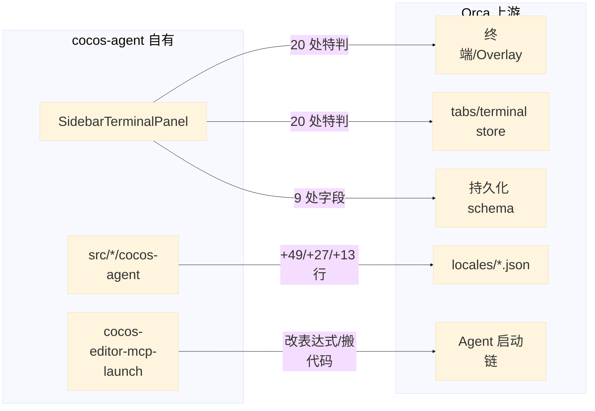
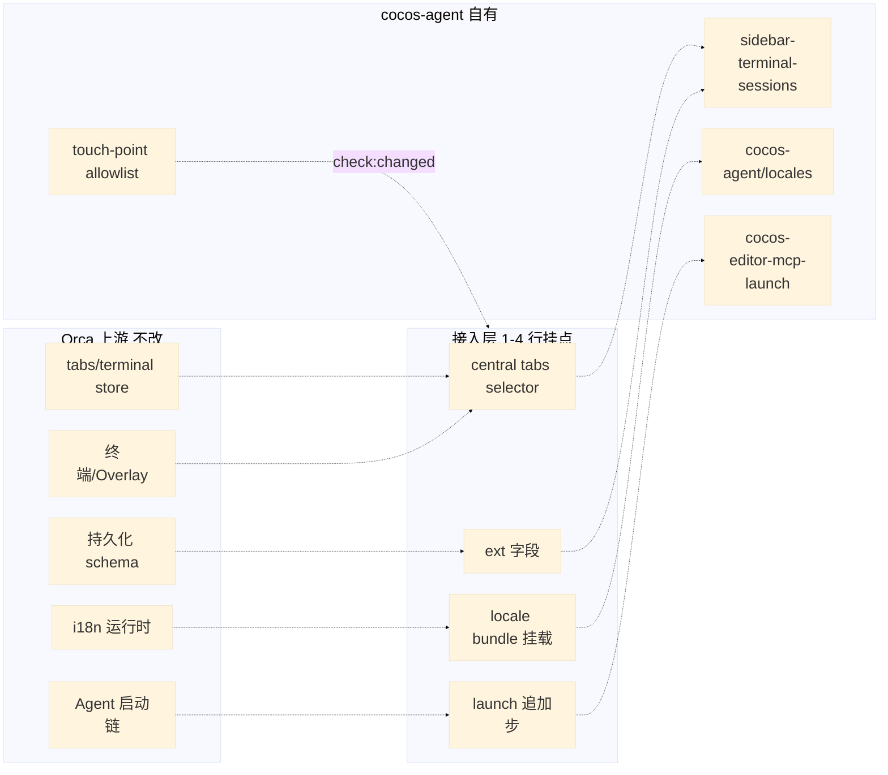
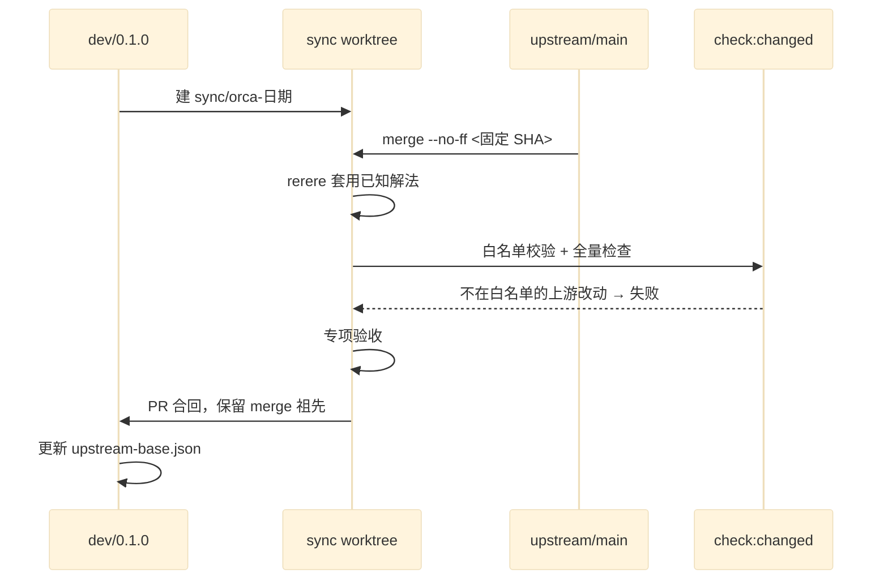

# RFC: cocos-agent 定期同步 Orca 上游的低冲突设计

| Field             | Value                                                                                                                                                                                                                                                                                                                                                |
| ----------------- | ---------------------------------------------------------------------------------------------------------------------------------------------------------------------------------------------------------------------------------------------------------------------------------------------------------------------------------------------------- |
| **Status**        | Implemented（2026-11-09，dev/0.1.1；待定项由作者定案见 Open Questions，实施记录见 blueprint.md）                                                                                                                                                                                                                                                     |
| **Date**          | 2026-11-08                                                                                                                                                                                                                                                                                                                                           |
| **Author**        | sky <sky.jp@a5labs.co>                                                                                                                                                                                                                                                                                                                               |
| **Source**        | 用户请求：「将来我想定期同步 orca 的代码，如何调整设计冲突会更少」，附一份外部分析（薄 fork + 接入层 + 固定版本包的三层建议）                                                                                                                                                                                                                        |
| **Supersedes**    | —                                                                                                                                                                                                                                                                                                                                                    |
| **Superseded by** | —                                                                                                                                                                                                                                                                                                                                                    |
| **Analysis mode** | graph-assisted — Step 0 通过（`list_repos` OK，`a5-game-context analyze` 全量重建），`impact` 上游方向测了 8 个符号并逐个核对 `target.filePath`（见 Impact Analysis）；改动文件的定位靠 git 而非图谱，故不标 `graph`；改动清单、行数和上游改动频率来自 `git diff --numstat` / `git log --name-only`（merge-base `974bb4a7cab` → `HEAD 8230b85a4eb`） |

## Summary

cocos-agent 是 Orca 的 fork，计划定期 merge 上游。现状是 fork 改动了 **62 个上游文件**（登记表只记了十几个），其中一些落在上游改动最频繁的文件上，每轮同步都会冲突。本 RFC 提出把改动按「冲突来源」分四类处理：语言文件改为运行时挂载的独立词条包；与 Cocos 无关的修复回馈上游；上游文件只允许「追加式挂点」并规定挂点形状；侧栏终端的 20 处特判收拢为一组自有能力。再加一个机械保障：`check:changed` 中比对「实际改动的上游文件」与白名单，登记表不再落后。预期：受上游高频改动影响的文件从约 25 个降到 10 个以内，剩余挂点均为 1–4 行追加。

## Motivation

- 上游 `stablyai/orca` 更新频繁（10 月至今 818 次提交碰过我们改动的文件），cocos-agent 需要持续吸收它的终端、Agent、工作区修复。
- `COCOS-AGENT-PLAN.md` 第 68 行的原始约束是「上游文件总共只改约 5 处、十来行」。实际已到 62 个文件、约 500 行，`COCOS-AGENT.md` 的登记表与实际脱节，同步时无法据此排查。
- 具体冲突热点已经可以预见：`i18n/locales/en.json` 在 10 月以来被上游改了 749 次，我们在里面加了 49 行；`persisted-ui-state-types.ts`（19 次）、`terminal-tab-close.ts`（16 次）、`shared/constants.ts`（14 次）、`spawn-options-assembly.ts`（10 次）都被我们改过。
- 有两处改动**搬走**了上游代码（`claude-agent-view-launch.ts` 删 41 行迁入新文件；`web-runtime-terminal-create-operation.ts` 拆函数），上游后续修这段逻辑时必然冲突，且修复会落到我们已不再使用的位置。
- 有 6 处改动修的是 Orca 自身的问题（与 Cocos 无关），留在 fork 里只会和上游的同类修复打架。

## Current State

### 改动分布（merge-base `974bb4a7cab`，2026-11-04 的 upstream/main）

| 类别                      | 文件数 | 代表                                                                                                                                                                                                                                                    | 性质                            |
| ------------------------- | ------ | ------------------------------------------------------------------------------------------------------------------------------------------------------------------------------------------------------------------------------------------------------- | ------------------------------- |
| 自有新增（不冲突）        | ≈90    | `src/main/cocos-agent/`、`src/renderer/src/cocos-agent/`、`SidebarTerminalPanel.tsx`、`config/electron-builder.cocos-agent.cjs`、`docs/cocos-agent/`                                                                                                    | 已符合「新文件优先」原则        |
| 品牌与打包常量            | 12     | `dev-instance-identity.ts`、`index.html`、图标、`bin/orca`、`updater-service.ts`                                                                                                                                                                        | 1–2 行或二进制替换              |
| 入口挂点（1–4 行追加）    | 8      | `main-process-ipc-bootstrap.ts`、`preload/index.ts`、`worktree-initial-terminal-seeding.ts`、`tab-bar-static-create-menu.tsx`、`main.tsx`                                                                                                               | 理想形状                        |
| 语言文件                  | 4      | `en.json` +49、`zh.json` +27、`zh-Hant.json` +13、`protected-copy-keys.json` +10                                                                                                                                                                        | 上游几乎每次提交都改            |
| 侧栏终端                  | 20     | `TerminalOverlaySlot`、`TerminalPaneOverlayLayer`、`TerminalLegacyTerminalPanes`、`tabs-focus-actions`、`terminal-tab-navigation/close/bulk-actions`、`use-tab-bar-item-projection`、`right-sidebar-state`                                              | 分散的 `isSidebarTerminal` 特判 |
| 持久化 schema（侧栏字段） | 9      | `persisted-ui-state-types`、`client-ui-params`（zod）、`ui-state-read`、`ui-selection-normalization`、`worktree-identity-migration`、`use-persisted-ui-writer`、`persisted-ui-write-baseline`、`ui-slice-hydration-actions`、`wsl-move-ui-dispositions` | 加一个字段要碰 9 处             |
| Agent 启动链              | 2      | `spawn-options-assembly.ts`（12/3）、`claude-agent-view-launch.ts`（3/41，搬走逻辑）                                                                                                                                                                    | 改了上游表达式 / 搬走代码       |
| 与 Cocos 无关的修复       | 6      | `agent-session-record-rows.ts`（SQLite NUL 键）、`runtime-agent-sender-history-triggers.ts`、`main-window-actions.ts`（后台启动不弹框）、`packaged-runtime-node-modules.cjs`（`isBuiltin`）、`install-dev-cli.mjs`、`resources/darwin/bin/orca`         | 应回馈上游                      |
| 其他                      | 1      | `browser-page-chrome-header.tsx`：为隐藏工具栏把整段 JSX 包了一层，diff 43/40                                                                                                                                                                           | 逻辑 1 行，形状 80 行           |

### 上游改动频率（2026-10-01 起，upstream/main）

| 被我们改过的文件                                                                                      | 上游提交次数                        |
| ----------------------------------------------------------------------------------------------------- | ----------------------------------- |
| `i18n/locales/en.json`                                                                                | 749                                 |
| `persisted-ui-state-types.ts`                                                                         | 19                                  |
| `store/terminals/terminal-tab-close.ts`                                                               | 16                                  |
| `shared/constants.ts`                                                                                 | 14                                  |
| `worktree-initial-terminal-seeding.ts`                                                                | 13                                  |
| `use-onboarding-and-feature-tips.ts` / `client-ui-params.ts`                                          | 12                                  |
| `main-window-actions.ts`                                                                              | 11                                  |
| `spawn-options-assembly.ts`                                                                           | 10                                  |
| `TerminalOverlaySlot.tsx` + `TerminalPaneOverlayLayer.tsx` + `terminal-tab-close.ts` + `constants.ts` | 同一上游提交 `7bf0377072f` 同时改动 |

### 现有同步流程

`COCOS-AGENT.md` § 同步上游：`git merge upstream/main` + `rerere`，合并后「对照上表检查每处改动是否还在」。登记表靠人维护，没有校验，已经落后于实际。

## Proposed Design

三条规则，一个机械校验，一组收拢。

### 规则

1. **上游文件只追加，不修改、不搬动。** 挂点只能是「加一行 import + 加一处调用」或「在上游表达式之后追加一步」。需要上游逻辑的通用版本时，复制到自有目录并登记「镜像自 X」，上游原文件保持原样。
2. **挂点形状以 diff 最小为准，而不是逻辑最小。** 隐藏工具栏用组件替换（`const Toolbar = isCocos ? Hidden : BrowserPageToolbar`，改一个标签名），不包 JSX；修改启动命令在上游 `launchCommand` 之后追加，不改它的三元表达式。
3. **与 Cocos 无关的修复不留在 fork 里。** 作为独立提交打上 `upstream-candidate` 标记并向 stablyai/orca 提 PR；上游合入后在下一轮同步中自然消失。

### Architecture Overview

### Component Design

#### cocos-agent 词条包（locale bundle）

- **Responsibility**: 承载所有 cocos-agent 自己的界面文案（`cocosSidebar.*` 等），启动时挂载到 i18next，不写进上游的 `locales/*.json`。
- **Location**: `src/shared/cocos-agent/` 下的三个 JSON 加一个挂载函数；主进程和渲染进程各挂一次。
- **Key interfaces**: 上游已有 `i18n.addResourceBundle(locale, 'translation', catalog)`（渲染进程 `loadRendererUiLanguage`）和插件语言包的 `replacePluginLanguagePackResources`。词条包用同一机制，键名加 `cocosAgent.` 前缀避免与上游键冲突；品牌后置处理器 `cocosAgentBrandPostProcessor` 保持不变。
- **Dependencies**: 上游 i18n 实例；挂载点是现有的 `orca-i18n-instance.ts` 挂点（已改 3 行）或渲染进程 `main.tsx` 的现有挂点，不新增上游改动。
- **影响**: `en.json`/`zh.json`/`zh-Hant.json`/`protected-copy-keys.json` 恢复原样，消除最高频的冲突源。

#### 侧栏终端能力收拢（sidebar-terminal-sessions）

- **Responsibility**: 把「这个终端显示在侧栏还是中央」「中央应显示哪些终端」「激活侧栏终端应做什么」「关闭/改名/移除工作区时如何清理」这四件事集中在一个自有模块，上游各处只保留一行调用。
- **Location**: 现有 `src/shared/sidebar-terminal-sessions.ts` 扩展为完整能力：`selectCentralTerminalTabs(state, worktreeId)`、`activateTerminalTab(state, worktreeId, tabId) → 'sidebar' | 'central'`、`onTerminalTabClosed(...)`。
- **Key interfaces**: 上游 `TerminalPaneOverlayLayer`、`TerminalLegacyTerminalPanes`、`use-tab-bar-item-projection`、`terminal-tab-bulk-actions` 都改为调用 `selectCentralTerminalTabs`（各 1 行）；`tabs-focus-actions`、`terminal-tab-navigation` 改为调用 `activateTerminalTab`（各 2 行）。
- **状态归属**: 侧栏状态（`sidebarTerminalSessionsByWorktree`、`sidebarTerminalFocused` 及其 action）从上游的 `right-sidebar-state.ts` 移入自有的 store slice，store 组合处只加一行展开；默认打开「终端」页、宽度 420 也由该 slice 在首次运行时写入，不再改 `getDefaultUIState`。
- **持久化**: `sidebarTerminalSessionsByWorktree` 不进 `PersistedUIState`。主进程 cocos-agent 服务在 userData 下保存自己的文件，渲染进程通过现有 `window.cocosAgent` IPC 读写；上游 9 个 schema 文件（类型、zod 合约、读取、归一化、迁移、写入、基线、hydration、WSL 迁移）全部恢复原样。工作区改名/移除的清理由自有 slice 响应现有挂点。web 客户端没有 preload，侧栏归属在那里不持久化——终端回到中央标签栏显示，不丢会话（与 WSL 迁移时的处理一致）。
- **第二阶段（待验证）**: 用上游已有的终端 portal 机制（`activity-terminal-portal.ts`：`setActivityTerminalPortals` + `TerminalOverlaySlot` 的 `createPortal`）把侧栏注册为 portal 目标，替代自加的 `inline` 分支。可行则 `TerminalOverlaySlot` 的 18/3 和 `TerminalLegacyTerminalPanes` 的 11/1 改动可以删除。
- **Dependencies**: 上游 store 的 `tabsByWorktree`、`activeTabIdByWorktree`；不新增。

#### Agent 启动挂点（cocos-editor-mcp-launch）

- **Responsibility**: 为 Claude/Codex 注入 Cocos MCP 配置并绑定编辑器。
- **Location**: 不变（`src/main/cocos-agent/`）。
- **Key interfaces**: 输入「上游算好的 launchCommand + 工作区/Agent/Shell 上下文」，输出「追加参数后的命令」。`spawn-options-assembly.ts` 从「改上游三元表达式」变为「上游 `launchCommand` 之后追加一行调用」。参数插入逻辑 `insert-agent-startup-args.ts` 作为上游 `withClaudeAgentViewPlugin` 的镜像副本保留在自有目录，上游文件恢复原样。
- **Dependencies**: 上游 `tokenizeStartupCommand` / `findClaudeExecutableIndex`（只 import，不改）。

#### 接入点白名单校验（touch-point allowlist）

- **Responsibility**: 让登记表成为机器校验的事实。`config/cocos-agent/upstream-touch-points.json` 列出允许改动的上游文件及每处的「冲突时怎么办」；`config/cocos-agent/upstream-base.json` 记录上次合入的上游 SHA、对应 cocos 包版本、验证结果。
- **Key interfaces**: `check:changed` 新增一项：`git diff --name-status <upstream-base> HEAD` 中不在白名单、又不在自有目录前缀下的文件 → 失败并打印文件名。新增挂点必须先登记。
- **Dependencies**: 现有 `config/scripts/check-changed.mjs` 的任务队列；只加任务，不改其调度。

#### 同步流程

- 每轮从 `dev/0.1.0` 开独立 worktree 和 `sync/orca-<日期>` 分支，`merge --no-ff` 固定的上游 SHA（优先已验证的 release 提交），通过 PR 合回并保留 merge 祖先，不 squash。
- `.gitattributes` 为图标等二进制挂点设 `merge=ours`；`rerere` 保持开启。
- 合并后依次：白名单校验 → `check:changed` → 专项验收（打开 Cocos 项目、侧栏 Shell/Agent、工作区切换、退出重开、编辑保存、成包）。
- 更新 `upstream-base.json`。Orca 基线升级与 Cocos 包升级分开交付。

### Data Flow

### API & Interface Changes

| Change             | Before                                                                             | After                                                                  | Impact                                                                   |
| ------------------ | ---------------------------------------------------------------------------------- | ---------------------------------------------------------------------- | ------------------------------------------------------------------------ |
| 侧栏终端持久化     | `PersistedUIState.sidebarTerminalSessionsByWorktree`（一等字段，9 处 schema 改动） | cocos-agent 自有文件 + `window.cocosAgent` IPC（0 处上游 schema 改动） | 旧数据首次启动时从 ui state 迁入自有文件一次；web 客户端不持久化侧栏归属 |
| cocos-agent 文案键 | `cocosSidebar.terminal.*` 写在上游 locales                                         | `cocosAgent.*` 在自有词条包，运行时挂载                                | 无用户可见变化                                                           |
| 启动命令挂点       | 替换上游 `launchCommand` 三元表达式                                                | 上游表达式不变，之后追加 `applyCocosEditorMcp(launchCommand)`          | 参数插入顺序与 `--plugin-dir` 互不依赖（都插在可执行文件之后）           |

## Alternatives Considered

### Alternative 1: 维持现状，只加强登记纪律

- **Approach**: 不改代码结构，把登记表补全，每轮同步人工对照。
- **Pros**: 零改动成本。
- **Cons**: 登记已经落后一次（12 vs 62），没有校验就会再落后；`en.json` 等高频文件每轮必冲突，人工解决 40 行重缩进的 JSX 冲突容易出错。
- **Measured**: 冲突面 = 当前 62 个文件，其中上游 10 月以来改过 ≥10 次的有 9 个（`git log --name-only`）。提案方案把这 9 个降到 3 个（`constants.ts`、`worktree-initial-terminal-seeding.ts`、`main-window-actions.ts` 保留 1–8 行追加）。
- **Why not chosen**: 不减少冲突，只是把成本留给每一轮。

### Alternative 2: 全部迁移为 Orca 插件

- **Approach**: 用上游插件接口（侧栏面板、`agent.launch.before` hook、工作区查询）承载编辑器容器、侧栏终端和 MCP 注入，fork 归零。
- **Pros**: 理论上不再有上游改动。
- **Cons**: 外部分析核对过上游插件文档：插件 frame 禁止直接访问网络、`terminal.read` 只回最多 2000 行纯文本，没有能无损承载完整交互终端和本地服务 URL 编辑器的接口；迁移等于重写两块核心功能。
- **Measured**: 需要替换的自有面是 `SidebarTerminalPanel`（复用上游 `TerminalPane` 全部输入/重连/退出保护）和 `cocos-editor-tabs`（浏览器标签内的本地服务页面）；图谱无法度量「插件接口能否承载」，依据是上游插件文档（外部分析引用）。
- **Why not chosen**: 当前接口不够，且会失去上游终端修复的直接受益。可作为长期方向逐项迁移状态展示类功能。

### Alternative 3: 补丁栈（patch stack）取代 merge

- **Approach**: 把 fork 改动维护为一组有序补丁，每次换上游基线时逐个 `git am`/rebase。
- **Pros**: 每个补丁职责清晰，哪个补丁失效一目了然。
- **Cons**: `COCOS-AGENT.md` 已约定用 merge：分支推到公司仓库后有其他人基于它开发，rebase 改写历史；62 个文件、约 90 个新文件的补丁栈重放成本高；与 Orca 自身的 merge 式历史不匹配。
- **Measured**: 需要重放的差异为 `git diff --stat` 的 ≈150 个文件；merge 方案只需解决冲突文件（提案落地后预计 <10）。
- **Why not chosen**: 违反已共享分支的历史约束，重放成本高于 merge。

### Alternative 4: 把侧栏终端贡献给上游

- **Approach**: 把「终端放进右侧栏」作为通用功能提 PR 给 stablyai/orca，上游承接后 fork 删掉这 20 + 9 处改动。
- **Pros**: 一劳永逸，且上游用户也受益。
- **Cons**: 取决于上游是否接受和何时合入，不可控；合入前仍需本 RFC 的收拢方案过渡。
- **Measured**: 同提案中「侧栏终端」部分：`impact(isSidebarTerminal, upstream)` MEDIUM，直接调用 7，其中 5 个在上游文件（`activateTab`、`setActiveTab`、`closeOtherTerminalTabs`、`closeTerminalTabsToRight`、`TerminalLegacyTerminalPanes`），2 个在自有文件；3 层共 11 个符号。贡献上游要动的就是这 5 个上游调用点加 9 个 schema 文件。
- **Why not chosen**: 不是替代方案而是后续选项；本 RFC 的收拢让这份贡献更容易被接受（改动集中、接口清晰）。

## Trade-offs & Risks

| Trade-off / Risk                   | Description                                                                                                                                                            | Mitigation                                                                                                             |
| ---------------------------------- | ---------------------------------------------------------------------------------------------------------------------------------------------------------------------- | ---------------------------------------------------------------------------------------------------------------------- |
| 镜像副本会与上游漂移               | `insert-agent-startup-args.ts` 复制了上游 `withClaudeAgentViewPlugin` 的 tokenization 逻辑，上游修复不会自动到达副本                                                   | 白名单登记为「镜像自 X」，同步时脚本列出 X 有改动即提醒对比；或在上游合入通用化版本后删除副本                          |
| 自有持久化绕过上游 UI 状态管道     | 侧栏归属不再随 ui state 跨客户端同步；web 客户端无 preload，归属不持久化                                                                                               | 归属只是展示偏好，丢失时终端回中央标签栏，会话不受影响；自有文件沿用 `normalizeSidebarTerminalSessions` 做运行时归一化 |
| portal 方案未验证                  | 侧栏作为 portal 目标可能与冷停（cold parking）、`isolatedPaneKey` 等上游机制冲突                                                                                       | 作为第二阶段，先用现有 e2e `cocos-sidebar-terminal.spec.ts` 做可行性验证，不通过则保留现有 `inline` 分支               |
| 回馈上游的 PR 可能不被接受或被改写 | 6 处修复若上游用别的方式修，fork 里的版本要让位                                                                                                                        | 标记为 `upstream-candidate` 独立提交；同步时优先采用上游版本并删除本地版本                                             |
| 同步演练前的未知适配               | 外部分析指出上游 `build:mac` 入口已迁到 `config/scripts/desktop-distribution/macos/`，本 fork 的 `build-cocos-agent-mac.mjs` 仍 import 旧路径（沙箱内无法 fetch 验证） | 第一轮同步演练时核对；白名单校验把「新增自有文件依赖的上游路径」也列为登记项                                           |
| 白名单校验误伤                     | 测试文件、文档等合理改动被拦                                                                                                                                           | 白名单支持前缀；`docs/cocos-agent/`、`src/*/cocos-agent/`、`tests/e2e/cocos-*` 默认放行                                |

## Impact Analysis

| Affected Area                                | Impact                                          | Severity | Evidence                                                                                                                                                                                                                                                                                                                                                                                                                                                                                                                                                                                                                  |
| -------------------------------------------- | ----------------------------------------------- | -------- | ------------------------------------------------------------------------------------------------------------------------------------------------------------------------------------------------------------------------------------------------------------------------------------------------------------------------------------------------------------------------------------------------------------------------------------------------------------------------------------------------------------------------------------------------------------------------------------------------------------------------- |
| 语言文件 `locales/*.json`                    | 恢复为上游原样，词条移入自有包                  | Low      | not measurable by the graph（数据文件）；`git log --name-only`：`en.json` 10 月以来 749 次上游提交                                                                                                                                                                                                                                                                                                                                                                                                                                                                                                                        |
| Agent 启动链 `assemblePtySpawnLaunchOptions` | 挂点形状改为追加，行为不变                      | Low      | `impact(assemblePtySpawnLaunchOptions, upstream)`：LOW，直接调用 2（`buildRuntimePtySpawnOptions`、`buildPtyIpcSpawnOptions`），3 层共 8 个符号，`target.filePath` = `src/main/ipc/pty/spawn-options-assembly.ts` 已确认                                                                                                                                                                                                                                                                                                                                                                                                  |
| `withClaudeAgentViewPlugin` 恢复上游实现     | 上游文件回到原样，自有副本承担通用插参          | Low      | `impact(withClaudeAgentViewPlugin, upstream)`：LOW，直接调用 1（`assemblePtySpawnLaunchOptions`），3 层共 5 个，`target.filePath` = `src/shared/claude-agent-view-launch.ts`；恢复原实现对调用方签名无影响                                                                                                                                                                                                                                                                                                                                                                                                                |
| 侧栏终端 store/渲染特判                      | 20 处特判收拢为 selector + action 调用          | Medium   | `impact(isSidebarTerminal, upstream)`：MEDIUM，直接调用 7（5 个上游文件：`activateTab`、`setActiveTab`、`closeOtherTerminalTabs`、`closeTerminalTabsToRight`、`TerminalLegacyTerminalPanes`；2 个自有：`SidebarTerminalCreateMenu`、`WorkspaceTerminals`），3 层共 11 个；`impact(selectSidebarTerminalSession)`：LOW，直接 2。`target.filePath` 均为 `src/shared/sidebar-terminal-sessions.ts`。另有 `useAppStore` 直接读 `sidebarTerminalSessionsByWorktree` 的 4 处（`TerminalPaneOverlayLayer`、`use-tab-bar-item-projection`、`TerminalOverlaySlot`、`TerminalLegacyTerminalPanes`）图谱无 CALLS 边，来自 `git diff` |
| `TerminalOverlaySlot` inline 分支            | 第二阶段改 portal 后可删除                      | Medium   | `impact(TerminalOverlaySlot, uid 精确)`：LOW，直接调用 2（上游 `TerminalPaneOverlayLayer`、自有 `WorkspaceTerminals`），3 层共 7 个；portal 方案只改自有调用方                                                                                                                                                                                                                                                                                                                                                                                                                                                            |
| 持久化 `getPersistedUI` 及 schema            | 9 个 schema 文件恢复上游原样，状态改存自有文件  | Medium   | `impact(getPersistedUI, upstream)`：LOW，直接调用 1（`profile-preferences.ts:getUI`），2 层共 2 个——恢复原样不影响调用方；schema 改动面从 9 文件降到 0（`git diff --numstat` 清单）                                                                                                                                                                                                                                                                                                                                                                                                                                       |
| 浏览器工具栏 `BrowserPageChromeHeader`       | 包裹 JSX 改为组件替换，diff 从 43/40 降到 ≈3 行 | Low      | `impact(BrowserPageChromeHeader, upstream)`：LOW，直接调用 1（`BrowserPagePane`）                                                                                                                                                                                                                                                                                                                                                                                                                                                                                                                                         |
| i18n 实例 `createOrcaI18n`                   | 挂载词条包，沿用现有 3 行挂点，签名不变         | Low      | `impact(createOrcaI18n, upstream)`：按数量 CRITICAL（2,732，第 2 层为所有 import i18n 的文件），但直接调用只有 2（`main-i18n.ts`、渲染进程 `i18n.ts`）；本设计不改签名、不改返回值，只在现有挂点内多挂一个 bundle，第 2 层的 import 关系不受影响                                                                                                                                                                                                                                                                                                                                                                          |
| 6 处通用修复                                 | 独立提交 + 上游 PR                              | Low      | not measurable by the graph（跨仓库流程）；清单来自 `git diff --numstat` 与各文件 diff 的人工分类                                                                                                                                                                                                                                                                                                                                                                                                                                                                                                                         |
| `check:changed`                              | 新增白名单任务                                  | Low      | 只追加任务；`config/scripts/check-changed.mjs` 本 fork 已改 3/1 行（并发上限），新任务放自有脚本文件                                                                                                                                                                                                                                                                                                                                                                                                                                                                                                                      |

## Open Questions

无待定项。以下原待定项由作者定案（用户要求不再征询），理由一并记录：

1. **持久化归属 → cocos-agent 自有文件 + 自有 store slice。** 0 处上游 schema 改动，优于「扩展字段」方案的 2 处（`persisted-ui-state-types.ts` 和 `client-ui-params.ts` 分别是上游每月改 19 次和 12 次的文件）。代价是 web 客户端不持久化侧栏归属，归属只是展示偏好，可接受。
2. **portal 方案的验证标准 → 现有 `cocos-sidebar-terminal.spec.ts` 全部通过，再加三个场景：切换工作区再切回（冷停恢复）、侧栏与中央终端焦点互切、侧栏终端进程退出后的清理。全过才用 portal，否则保留 `inline` 分支。** 属第二阶段，本 PR 不含。
3. **上游 PR → 一个 PR，每处修复一个独立提交（实施时为 7 个，`check:changed --maxWorkers` 也归入）。** 每个提交自成一体（含说明），上游可整体合并也可单独 cherry-pick。
4. **同步目标 → 每轮取当时最新的 release tag；只有需要尚未发布的修复时才取 main 上指定提交。** 具体 SHA 在开发机 fetch 后写入 `upstream-base.json`。
5. **登记表 → JSON 为唯一来源。** `COCOS-AGENT.md` 的表由脚本从 JSON 生成，校验任务同时检查 Markdown 与 JSON 一致。
6. **docs/specs 的 gitignore → 已加白名单两行**，与 `docs/cocos-agent/` 相邻。
7. **交付方式 → 第一阶段（规则 1–3、词条包、侧栏收拢、白名单校验、同步流程文档）作为一个 PR 合入 `dev/0.1.0`**；上游修复另开一个面向 stablyai/orca 的 PR。

## References

- `COCOS-AGENT.md` § 改动原则 / § 同步上游（merge + rerere 约定，登记表）
- `COCOS-AGENT-PLAN.md` 第 68 行（原始约束「上游文件只改约 5 处」）、第 300 行（用 loop 定期同步上游）
- 上游 i18n 挂载机制：`src/renderer/src/i18n/i18n.ts` `loadRendererUiLanguage` → `addResourceBundle`；`src/shared/plugins/plugin-language-pack-i18n-resources.ts`
- 上游终端 portal 机制：`src/renderer/src/components/activity/activity-terminal-portal.ts`
- 外部分析（用户附带）：三层责任划分、同步分支流程、插件接口限制、`build-mac-local.mjs` 路径迁移（未在本机验证）

**Prior art:** 本地：`COCOS-AGENT.md` § 同步上游（merge/rerere 约定）与 `COCOS-AGENT-PLAN.md` 第 68 行的「上游文件只改约 5 处」原则是本 RFC 的直接前身，本 RFC 把它从约定变为校验；`docs/cocos-agent/` 内无同步设计文档；`docs/specs/`、`docs/archive/`、`docs/architecture/` 不存在。External prior art: not checked — 本仓库不在 `a5-source-map` 的 Jira/Confluence 项目范围内，无可路由的外部来源。

**Evidence sources:** 改动文件清单与行数：`git diff --numstat/--name-status 974bb4a7cab HEAD`；各挂点形状：`git diff` 逐文件 Read；上游改动频率：`git log --since=2026-10-01 --name-only upstream/main`；i18n 与 portal 扩展点：Read；blast radius：`impact` 上游方向（`assemblePtySpawnLaunchOptions`、`getPersistedUI`、`BrowserPageChromeHeader`、`withClaudeAgentViewPlugin`、`isSidebarTerminal`、`selectSidebarTerminalSession`、`TerminalOverlaySlot`（同名测试桩歧义，改用 uid）、`createOrcaI18n`），`target.filePath` 逐个核对。首次查询时索引停在 `f2446b9`（未含 11-06 后的侧栏终端代码），已用 `a5-game-context analyze` 全量重建后复测。

**Graph-checkable but code-read:** `loadRendererUiLanguage → addResourceBundle` 与 `setActivityTerminalPortals` / `findActivityTerminalPortal` 的调用关系来自 Read，未跑 `callees` / `context`——两处只用来确认扩展点存在，影响范围已由 `impact(createOrcaI18n)`、`impact(TerminalOverlaySlot)` 覆盖；`useAppStore` 选择器对 `sidebarTerminalSessionsByWorktree` 的 4 处直接读取图谱没有边，依据 `git diff`。`claim-coverage.md` 的其余行（场景层级、`@property`、引擎语义）不适用于本仓库。
